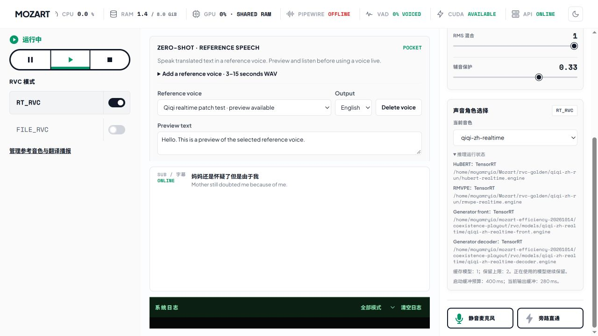

# 实时效率与输出连续性验证

日期：2026-10-14。代码基线：`daf16b1`。测试设备通过 `ssh jetson` 直连。
本轮实现 GPU 张量直连、特征并行、按需加载、模型缓存回收和实时输出启动预算。
固定输入的十二轮短测及最终复测中，优化前后的音频样本完全一致。
120 s 组合测试完成全部 23 句播报，修复后的 RVC 没有启动后欠载。

## 实现

- TensorRT 在同一 CUDA stream 中连接 Generator front 与 decoder。
  中间张量 `z` 保留于 GPU，只回拷最终音频。
  CPU／ONNX 路径保留主机张量连接。
- HuBERT 与 RMVPE 重叠执行。Generator 等待两个条件分支完成。
- 配置 realtime 特征路径后，quality 特征引擎在首次使用时加载。
  模型管理器默认保留两个缓存对象。正在使用的模型继续保留；闲置对象按最近使用顺序回收。
  缓存命中不重复加载权重。加载失败不替换当前模型。
- 状态接口和前端显示实际后端、资产路径、回退原因和输出缓冲时长。
  CUDA 执行提供程序的配置状态与全部算子 GPU 执行明确区分。
- TensorRT 输入检查覆盖名称、形状、布局、类型和整数范围。
  int32 转换缓冲区保留到排队工作完成。异常路径完成同步后再释放输入。
- 实时输出默认使用 `400 ms` 最小启动等待预算。
  预算从首个输入契约帧开始计量，覆盖静音转有声和计算抖动。
  此机制只改变输出时序，不改变音频样本、顺序或数量。

## 配置与统计范围

设备为 Jetson Orin Nano Super 8GB，系统为 Linux 6.8.12-1021-tegra。
读取的功耗模式为 `MAXN_SUPER`。本轮没有修改功耗配置或桌面服务。
原版与候选均使用 Release、ONNX Runtime 1.29.0 和 TensorRT；CUDA EP 编译选项关闭。
实时四阶段均加载 TensorRT `.engine`。完整源码和二进制摘要见[清单](source-runtime.json)。

实时模型为 `qiqi-zh-realtime`，输出为 48 kHz，特征维度为 768，speaker ID 为 0。
块长为 240 ms，历史为 2.5 s，SOLA 交叉淡化为 50 ms，搜索为 10 ms。
固定参数为 pitch shift 0、index rate 0、filter radius 3、RMS mix 1、protect 0.33。
RVC 文件输入不经过 RNNoise 或 VAD。冲洗输入为 3 s 静音。

短测输入由 `espeak-ng -v zh -s 145` 生成，随后固定为 16 kHz 单声道 WAV。
文本为“你好，这是实时语音测试。今天的天气很好。”。
全部对照复用同一文件，包含 134,382 个样本，时长为 8.398875 s。

短测按四种配置各运行三轮。第二轮反转配置顺序。
每种配置包含 141 个推理块；推理统计合并三轮，包含冲洗块，不包含构造阶段预热。
推理计时使用后端 `steady_clock`，从实时推理入口到最终音频返回。
启动计时从创建进程到首次状态请求成功；进程 RSS 取此时的 `/proc/<pid>/status`。
启动和 RSS 表内数值为三轮中位数。RSS 不代表整机或全部 GPU 共享内存。

## 单独运行结果

此组为计算与资源对照，显式关闭新增启动预算。

| 配置 | 推理中位数 | 推理 p95 | 启动中位数 | 就绪 RSS 中位数 |
| --- | ---: | ---: | ---: | ---: |
| 原版 | 67.938 ms | 68.562 ms | 8.180 s | 2,279.7 MiB |
| 候选，关闭直连及并行 | 67.901 ms | 68.827 ms | 4.541 s | 1,399.3 MiB |
| 候选，仅 GPU 直连 | 67.462 ms | 67.990 ms | 4.546 s | 1,400.1 MiB |
| 候选，直连及并行 | 63.991 ms | 64.744 ms | 4.541 s | 1,399.5 MiB |

本组完整候选的推理中位数减少约 5.8%，进程 RSS 减少约 880 MiB。
启动中位数减少约 44.5%。按需加载是本组启动和内存变化的主要代码差异。
十二轮输出的 PCM SHA-256 相同。全部无推理错误、丢块、输入溢出或启动后欠载。
该组首帧等待均为 300 ms。此值不含物理声卡延迟。

独立 Generator 配对基准各测量 50 次，另各预热 10 次。
最终构建的主机回拷路径中位数为 22.233 ms，GPU 直连为 21.798 ms。
120 次预热及测量调用的输出均与参考逐样本一致；20 次并发调用也一致。
非法布局和输出名称均被拒绝，拒绝后可继续推理。

## Golden 与 ONNX

先运行原始 PyTorch RVC，保存输入、mel、F0、特征、离散音高、连续音高和 Generator 张量。
检查点为 RVC v2、F0 启用、48 kHz、202 个 speaker、768 维特征。
检查点摘要与既有 Golden 清单一致。
随后用相同捕获张量检查部署 ONNX，不重新导出或替换实时权重。

| 阶段 | 输出形状 | 相对均方根误差 | 最大绝对误差 |
| --- | --- | ---: | ---: |
| HuBERT | `[1,139,768]` | 1.71e-6 | 8.58e-6 |
| RMVPE salience | `[1,32,360]` | 7.24e-7 | 8.34e-7 |
| Generator front | `[1,192,30]` | 3.97e-7 | 2.74e-6 |
| Generator decoder | `[1,1,14400]` | 2.35e-6 | 1.64e-6 |
| ONNX front 与 decoder 串联 | `[1,1,14400]` | 2.61e-6 | 1.64e-6 |

上述输出均为有限的 float32，余弦相似度均高于 0.99999999999。
RMVPE 使用 `[batch, mel_bin, time]`；HuBERT 使用 v2 的最后一层 768 维输出。
最终后端复测使用相同输入和 `400 ms` 启动预算，PCM 仍与原版短测完全一致。

上游实时 PyTorch 与后端的频谱相关系数为 0.9852，F0 中位差为 10 cents，p90 为 42 cents。
比较的共同时间线为 8.38 s；上游参考长 8.39 s，裁剪后的后端长 8.38 s。
这是实时参考的客观比较，不是逐样本等价关系。优化前后后端的等价关系另以 PCM 检查确认。

## 组合运行与欠载修复

组合输入为保留的 120 s 预处理 WAV，不重复运行 RNNoise。
识别使用 Zipformer 14M，翻译使用 GPU Qwen 0.8B Q4_K_M。
PocketTTS 使用 CPU int8、两线程、五步生成、固定 Qiqi 参考 WAV 和提前输出运行时。
句界分类器使用 CPU 单线程。资源清单见[资产摘要](assets-manifest.json)。

测试使用两个独立原生 API 进程，共享 CPU、GPU 和内存。
翻译播报按音频时长写入 ALSA `null`；RVC 使用定速 UDP 文件回放。
RVC 从开始推理至最终音频返回计时。首帧等待按启动空帧数乘以 20 ms 计量。
播报首播从最终识别事件至首个播放管道块计时，不代表实体扬声器发声时间。

首轮关闭启动预算时，512 个推理块均未超时，但出现 3 个启动后欠载帧。
最大推理块耗时为 125.419 ms，明显短于 240 ms 块长。
问题来自播放余量：首块较快完成后立即输出，后续较慢的块仍可使输出环暂时为空。
静音首块可瞬时完成，因此不能仅按首块完成时刻安排后续播放。

新增确定性回归模拟静音转有声及 120 ms 计算抖动。
无预算路径出现六个空帧；按音频时钟设置启动预算后没有空帧。
两条路径按序连接的全部 PCM 样本一致。重置后重新计量预算。

最终 `400 ms` 配置的 120 s 组合结果如下：

| 指标 | 结果 |
| --- | ---: |
| RVC 推理块数 | 512 |
| RVC 推理中位数／p95／最大值 | 64.665／102.006／132.677 ms |
| RVC 启动后欠载、推理错误、丢块、输入／输出溢出 | 全部为 0 |
| RVC 首帧等待 | 400 ms |
| 完成播报原句／最终识别原句 | 23／23 |
| 完成任务／播报任务 | 41／41 |
| 原文提交范围完整／最终识别原句 | 23／23 |
| 自动翻译检查通过／最终识别原句 | 22／23 |
| 最终识别至首播中位数／最大值 | 8.278／11.436 s |
| 句内音频交界／超过 20 ms 的交界间隙 | 97／0 |
| 句内最大交界间隙 | 16.70 ms |
| 生成音频块与完整 WAV 一致的任务 | 41／41 |
| 采集帧／采集溢出 | 6,000／0 |
| 最低整机可用内存 | 2.906 GiB |
| 退出时等待任务、存储警告、预热错误和残留测试进程 | 全部为 0 |

最小启动等待从本机单独运行的约 300 ms 增至 400 ms，以覆盖本轮组合负载的抖动。
设置 `rvc.realtime_playout_delay_ms: 0` 可关闭预算；有效范围为 0–1000 ms，步长为 20 ms。
不同模型和更高负载仍需分别测量。超过预算的首块会继续等待，不发布未就绪音频。

第 5 句仍含识别和翻译问题，自动检查检出英文中的中文残留。
系统按既有覆盖率策略保留候选、警告和播报，没有把该句记作翻译质量通过。
123.60 s 播报仍长于 120 s 输入；本轮没有证明长期同声播报时延稳定。
完整逐句记录保存在原始产物中，可用于后续语义和播放需求整改。

## 文件与界面回归

文件回归使用同一 espeak 输入和已锁定的固定 `T=398` Generator。
原版和候选输出 PCM 完全一致。候选在首次文件推理时加载 quality 特征。
状态正确报告 RMVPE 形状不匹配后的动态 ONNX CPU 回退。
此项为功能回归，不宣称文件推理提速或新的动态 Generator 支持。

额外探针发现旧归档 `qiqi-zh-dynamic.onnx` 在 `T=1039` 时发生 Reshape 错误。
原版基线同样失败。该文件没有进入已通过资产，也没有替换生产模型。
原始错误记录保留在 `file-verification/`；固定资产回归保存在 `file-fixed-verification/`。

前端用已捕获的状态、字幕和播报记录验证展开详情、资产路径与缓冲预算。
检查发现桌面根容器没有继承视口高度，较长的播报历史使右侧详情超出可滚动区域。
已补齐根容器的弹性布局与高度约束，并复查详情可以滚动到末尾。
截图为测试快照，不是实体设备现场运行画面。

## 回归与复测

| 检查 | 结果 | 范围 |
| --- | --- | --- |
| 主机原生回归 | 25／25 | Debug，无 ONNX／TensorRT；包含 HTTP、UDP、文件生命周期和预处理 |
| Jetson 原生回归 | 22／22 | Release，ONNX／TensorRT 构建；根构建关闭独立预处理测试 |
| Python 工具 | 147／147 | 字幕、翻译检查、播报、持久队列和退出 |
| 前端 | 11 个用例通过；类型检查和生产构建通过 | 两个测试文件，含运行时选择与字幕更新 |
| 真实资产 | 通过 | PyTorch／ONNX、GPU 直连、并发调用、最终 UDP 复测和组合运行 |

Jetson 根构建的测试在 `build-candidate/rvc-backend` 注册。
复测使用 `ctest --no-tests=error`，避免将空测试集当作通过。
完整指标见[统计 JSON](metrics.json)，源码和二进制对应关系见[摘要清单](source-runtime.json)。

可复用脚本为：

- `rvc-golden/verify_realtime_split.py`：相同张量的 PyTorch／ONNX 对照。
- `rvc-golden/benchmark_trt_chain.cpp`：主机回拷与 GPU 直连的配对基准。
- `rvc-golden/run_efficiency_campaign.py`：固定输入、配置交替和严格流检查。
- `rvc-golden/run_efficiency_coexistence.py`：组合运行及分段播报验收。
- `rvc-golden/verify_efficiency_file.py`：指定已验证资产的文件回归。

Jetson 独立目录为 `/home/moyamryia/mozart-efficiency-20261014/`。
本地输入、输出和张量位于 `rvc-golden/runtime-efficiency-20261014/`，大型产物由 Git 忽略。
源代码、回归和摘要保存在当前 Git 分支。

## 并排试听

| 产物 | 文件 | 范围 |
| --- | --- | --- |
| 原始输入 | [espeak 输入](../../rvc-golden/runtime-efficiency-20261014/reference/input/qiqi-espeak.wav) | 完整固定输入 |
| Golden | [原始离线 PyTorch](../../rvc-golden/runtime-efficiency-20261014/reference/output/qiqi-espeak-python-reference.wav) | 完整离线参考 |
| Golden | [上游实时 PyTorch](../../rvc-golden/runtime-efficiency-20261014/reference/output/qiqi-espeak-upstream-realtime-python-reference.wav) | 同一实时契约 |
| ONNX | [Generator 同张量片段](../../rvc-golden/runtime-efficiency-20261014/reference/all-stages/qiqi-espeak-split-onnx.wav) | 捕获张量末段的 0.3 s 探针，非完整句子 |
| 后端原版 | [原版实时输出](../../rvc-golden/runtime-efficiency-20261014/campaign-short/baseline-1/qiqi-espeak-baseline-mozart-backend.wav) | 关闭新增预算 |
| 后端最终版 | [最终实时输出](../../rvc-golden/runtime-efficiency-20261014/campaign-final/parallel-1/qiqi-espeak-parallel-mozart-backend.wav) | 400 ms 启动预算；内容样本与原版一致 |
