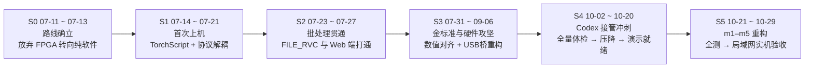

# Project-Mozart 人机协同开发记录与架构演进报告

> **项目对象**：面向 NVIDIA Jetson Orin Nano（8GB）的端侧低时延实时语音转换与处理系统  
> **工程体量**：110 天周期（2026-07-11 13:59 → 2026-10-29 22:18）/ 主干 322 次提交（HEAD `54d477d`，含全部分支 353 次）/ 13 个本地分支与 22 个远程跟踪引用 / 13 GB 磁盘占用（含 11 GB 测试基准）/ 57 个报告目录 / 发布标签 `v0.1.0-demo`（指向 10-22 的 `2d9487e`）  
> **实测指标**：冷启动首帧时延 320 ms，稳态处理时延中位数 88 ms（P95 93 ms），全双工 USB 用户态声卡桥（30 min 加压无卡顿）  
> **记录范围**：全案 254 条直接工程记录（Jetson OpenCode 112、本机 Codex 11、开发档案 131），构建异构双机协同、多轨独立审查与金标准数值闭环  

---

## 目录

- [一、研发演进脉络与关键突破（S0–S5）](#一研发演进脉络与关键突破s0s5)
  - [S0 路线确立：放弃 FPGA，收敛纯软件栈（07-11 → 07-13）](#s0-路线确立放弃-fpga收敛纯软件栈07-11--07-13)
  - [S1 首次上机：模型端侧加载与网络解耦（07-14 → 07-21）](#s1-首次上机模型端侧加载与网络解耦07-14--07-21)
  - [S2 批处理贯通：FILE_RVC 与 Web 控制台（07-23 → 07-27）](#s2-批处理贯通file_rvc-与-web-控制台07-23--07-27)
  - [S3 金标准确立与硬件攻坚：数值对齐与 USB 桥重构（07-31 → 09-06）](#s3-金标准确立与硬件攻坚数值对齐与-usb-桥重构07-31--09-06)
  - [S4 开发机接管：系统体检、效率压降与演示就绪（10-02 → 10-20）](#s4-开发机接管系统体检效率压降与演示就绪10-02--10-20)
  - [S5 架构重构与实机闭环验收（10-21 → 10-29）](#s5-架构重构与实机闭环验收10-21--10-29)
- [二、核心技术决策与架构演进](#二核心技术决策与架构演进)
- [三、人机协同工程方法论与创新实践](#三人机协同工程方法论与创新实践)
  - [3.1 工具分工与多轨独立审查流水线](#31-工具分工与多轨独立审查流水线)
  - [3.2 研究与执行物理隔离：只读子代理机制](#32-研究与执行物理隔离只读子代理机制)
  - [3.3 金标准模型驱动的确定性质量闭环](#33-金标准模型驱动的确定性质量闭环)
  - [3.4 针对 AI 代码膨胀的逆向防御性清理](#34-针对-ai-代码膨胀的逆向防御性清理)
  - [3.5 协同过程的反思与局限性控制](#35-协同过程的反思与局限性控制)
- [四、改动清单：原句 → 改句 → 理由](#四改动清单原句--改句--理由)

---

## 一、研发演进脉络与关键突破（S0–S5）

研发全流程经历两种工具生态的分工接力：**前期（S0–S3，7–9 月）由 Jetson 端 OpenCode 主导**完成硬件探路、模型端侧部署与金标准数值对齐；**后期（S4–S5，10 月）由开发机 Codex 主导**完成工程重构、性能压降与最终交付闭环，并由 Pi 与 ZCode 提供多角度只读审查。



### S0 路线确立：放弃 FPGA，收敛纯软件栈（07-11 → 07-13）

- **技术命题**：评估在 NVIDIA Jetson Orin Nano 单板算力下实现全实时语音处理的可行性；抉择选用 ZYNQ 7010/7020 FPGA 异构方案还是纯软件架构。
- **关键动作与事实**：
  - 07-11：首条工程会话确立预处理（pre）与后处理（post）解耦架构：预处理输出“高信噪比音频流”，后处理执行深度学习变声（558 条消息）。
  - 07-11：对 ZYNQ 7010/7020 核心板原理图进行排查（253 条消息），确认硬件底板未引出 I²S/PDM 音频引脚至高速 BTB 接插件，阻断了低成本 FPGA 硬件路线。
  - 07-12：执行“记住 doc 中的非 FPGA 方案”（572 条消息），系统架构正式转向纯软件技术栈；同日完成代码库 Markdown 文档的规范性重写与结构对齐（396 条消息），并在独立会话中就 RNNoise 静态嵌入权重导致可执行体积膨胀的问题展开技术评估（50 条消息）。
  - 07-13：部署 RVC 后端核心服务（537 条消息）；同日针对系统运行时与硬件拓扑重建依赖，分两次会话完成 PyTorch 环境部署（122 条与 110 条消息）。
- **关键突破**：确立了 `C/C++ 预处理 (RNNoise) + RVC 后端 (ONNX/TensorRT)` 的全软件运行架构。前身仓库 `mozart-pre-remake` 中基于 SystemVerilog 实现的 I²S RTL + 定点 DSP 逻辑归档为参考资产，项目全面转向嵌入式 Linux 软件流水线。

### S1 首次上机：模型端侧加载与网络解耦（07-14 → 07-21）

- **技术命题**：完成开发机训练导出的神经网络模型向 Jetson Orin Nano 嵌入式 C++ 服务运行时的移植与跑通。
- **关键动作与事实**：
  - 07-14：建立开发机到嵌入式板卡的代码同步链路，使用 `git format-patch` 结合 `scp` 将本地提交批量同步至板端（162 条消息）。
  - 07-16：在 `rvc-backend/src/rvc/inferencer.cpp` 中引入 libtorch 运行时加载 110 MB 的 `de_narrator.ts`（PyTorch 2.1 JIT trace 导出模型）。首次会话 3 条消息后因异常中断，随后重新开启独立会话经 841 条消息完成模型加载与基础推理集成，形成项目首个端到端模型接入记录。档案可核对该步的三项事实：PC 端 2026-07-16 01:50 生成 `de_narrator.ts`（115,541,161 字节，约 110 MiB，PyTorch 2.1 JIT trace）；该文件经 `scp` 传到板端 `~/models/`；板端代理收到 `torch::jit::load` 加 `inferencer.cpp: run_generator()` 的集成指令。Git 在 07-14 至 07-19 之间没有提交，板端集成也没有形成提交。首个推理引擎提交出现在 07-20：`8bcaa1d`（HuBERT ONNX 导出）、`dd11544`（RMVPE 导出）、`b006fdb`（Generator 导出）、`5a33dc6`（ONNX Runtime 构建支持）、`b3feae7`（ONNX engine 与索引检索）。07-31 的计划复核仍把 `run_generator()` 记为 TODO 状态，最终落地的是 ONNX 与 TensorRT 路径。
  - 07-20：展开 Jetson Orin Nano 实机主部署（1,397 条消息），随后调度只读子代理专门审计 UDP 18000 端口的双向音频流传输契约。
- **关键突破**：实现 ALSA 预处理客户端与基于 UDP 18000 端口的 RVC 后端分离部署；TorchScript 验证了端侧模型推理的技术可行性，为后续过渡到高性能 ONNX Runtime 与 TensorRT 奠定管线基础。

### S2 批处理贯通：FILE_RVC 与 Web 控制台（07-23 → 07-27）

- **技术命题**：在流式处理之外补齐离线音频文件转换流水线，并建立基于 Web 浏览器的交互与控制前端。
- **关键动作与事实**：
  - 在 `Seeck_Mozart` 工作区目录下开展系统重构，设计 `state_manager` 状态机逻辑并定义 FILE_RVC 模式下的 RESTful 与 WebSocket 协议接口（1,775 条消息）。`state_manager` 模块的首个提交为 07-14 的 `c6d9237`；07-23 的提交为前端原型 `73fadac` 与硬件状态面板 `531e87e`；07-27 的 `9a8a799`、`d0d3854` 补齐控制中心与 FILE_RVC 部署说明。
  - 调度 6 个 explore 只读子代理分别对状态机状态转移、守护进程接口、前端组件集成、模型资产路径规范、Zero-Shot 批处理机制以及 PipeWire 音频路由展开并行技术调查。
  - 07-27：针对 VSCode Remote 端口转发配置冲突（18080 与 5173 端口占用）排查并恢复开发环境（1,480 条消息）。
- **关键突破**：打通包含音频上传、排队调度、模型转换、异常取消与成品下载的完整 FILE_RVC 离线批处理管线；前端交互界面由早期原生内联脚本升级为模块化的 Vite + TypeScript 单页架构。

### S3 金标准确立与硬件攻坚：数值对齐与 USB 桥重构（07-31 → 09-06）

- **技术命题**：系统性解决变声主观音质异常与精度损失问题；攻关 USB 虚拟声卡硬件拓扑，使板卡被宿主机识别为标准音频设备。
- **关键动作与事实**：
  - 07-31：本机 Codex 执行两项架构基准任务：核查 Frank-nju 方案（PC 预编译 PyTorch 导出，嵌入式端直接运行 C++ 与 ONNX）的工程完成度（25 轮）；在本地搭建标准 RVC WebUI 环境作为全流程金标准对比系统（78 轮）。
  - 08-23：分析并实施 Jetson 直连 USB 四通道阵列麦克风硬件方案（289 条消息）；08-28 会议纪要（204 条消息）固化三项关键决策：终止 RK 平台 NPU 迁移路径、确定最终演示形态要求、制定 RNNoise 调参方案；08-29 状态全面盘点（4,168 条消息）将决策分解为待办工单。
  - 08-31：就主观音质劣化展开系统排查（1,292 条消息），从镜像源系统筛选 5 个验证模型；09-01 明确以数值基准指导优化，要求 C++ 后端输出严格对齐金标准模型（259 条消息）。
  - 09-01：针对前期代理在代码修改中引入的逻辑异常执行复盘排障（1,905 条消息）；同步开展代码库过度工程专项排查与代码移除影响分析（98 条与 188 条消息）。
  - 09-02 与 09-05：两次深度复现 `qiqi-zh-espeak-pinyin-mixed-python-reference.wav` 参考基准（7,461 条与 6,931 条消息），推动音质评价体系由主观试听全面升级为与 Python 参考管线的逐样本均方误差比对。
  - 09-03：排查 TensorRT FP16 混合精度下数值不稳定问题（277 条消息）；09-05 至 09-06 排查 `usb-gadget` UAC2 设备枚举失败与内核崩溃问题，主代理实施底层修改，子代理严格约束在离线回归测试开发范围内。
- **关键突破**：构建起 `rvc-golden/` 验证资产体系（33 个目录，共 11 GB）。`rvc-golden/golden_manifest.json` v4 锁定 5 项标准：`offline-audible`、`offline-deterministic`、`streaming-deterministic`、`streaming-quality-audible`、`streaming-quality-deterministic`，并登记 2 组参考用例。USB 接口侧，09-06 的提交 `0acb212` 以 Tegra234 XUDC 不支持等时端点为由关闭 UAC2 gadget 路线；`usb-gadget/DECISION.md` 同时记录 09-05 的 panic、ramoops 与 DMA/completion 修复候选。关闭后先回退外接 USB 声卡，10-20 完成两端 `snd-aloop` 加 FunctionFS bulk 的用户态全双工桥（合并提交 `9e0799f`，10-21 14:30），30 分钟受压与拔插、重启恢复已验。

### S4 开发机接管：系统体检、效率压降与演示就绪（10-02 → 10-20）

- **技术命题**：接管前期实机代码，实施代码规范性治理、性能优化与演示就绪性强化。
- **关键动作与事实**：
  - 10-02：通过开发机无缝接管板端工程，指令原话为：`"SSH jetson-wg, and see ~/Mozart for more details. Is there anything we can do? By the way there's a PR on github, help me check and merge."`
  - 阶段推进矩阵：
    - **P1 全量体检 (10-02 → 10-05)**：SSH 连接实机合并未清 PR，执行全管线冒烟测试（`reports/full-run-20261005`）。
    - **P2 可靠性强化 (10-06 → 10-07)**：长文本连续音频转换、动态音频分块、负载过载诊断（`reports/reliability-20261006`）。
    - **P3 规范清洗 (10-08 → 10-13)**：英文技术文档按 ASD-STE100 标准重构，执行代码库审计并部署流式补丁（`reports/repository-audit-20261008`、`reports/repository-audit-20261013`）。
    - **P4 效率优化 (10-13 → 10-16)**：实施运行时优化，建立逐模块时延基线（`reports/efficiency-20261014`、`reports/feature-latency-20261014`）。变速上限在 10-16 由 1.05 提升至 1.15（`reports/tempo-limit-20261016`），在 10-20 再由 1.15 提升至 1.50（`reports/tempo-cap-20261020`）。
    - **P5 交付评估 (10-16)**：开展交付指标评估，Pi 介入只读代码与文档审查（`reports/delivery-20261016`）。
    - **P6 演示固化 (10-17 → 10-20)**：修复音频缓冲队列积压，突发耗时从 47.6 s 降低至 23.2 s；联调 USB 用户态桥接（`reports/backlog-fix-20261019`）。
- **关键突破**：解决音频积压突发阻塞，实现了系统从单一核心功能可用向完整现场演示态的过渡。

### S5 架构重构与实机闭环验收（10-21 → 10-29）

- **技术命题**：系统最终工程重构、模型选型收敛与硬件局域网闭环验收。
- **关键动作与事实**：
  - **P7 零样本转换与模型选型 (10-21 → 10-23)**：MeanVC2 零样本变声模型在 8GB 共享显存环境下引发 OOM，零样本接口规范退守为标准 HTTP 501 状态码预留；端侧轻量翻译模型经多版本选型，收敛确定为 0.8B 规模量化模型。
  - **P8 m1–m5 重构与审查 (10-24 → 10-25)**：落实 M0–M5 六项里程碑：WOLA 谱降噪参考实现、预处理器单干重构（WOLA 主干、直出路由与控制通道）、USB 桥协议双流（STREAM_FAST）、快流专用端点、控制面二进制协议第一步与 dtln AI 分支验证（`reports/wola-m0-20261025` 至 `reports/m5-dtln-20261025`）；同期建立端到端（e2e）与音频环路（loop）时延量化分析（`reports/e2e-latency-20261025`、`reports/loop-latency-20261025`）；ZCode 介入并执行覆盖全项目与重点模块的 28 条只读审查。
  - **P9 全项目代码审查与字幕链路 (10-26 → 10-27)**：Pi 开展覆盖全代码库结构的深度通读（产生原始事件 5,749 条，清洗后保留核心会话 631 条，为整个项目周期规模最大的单次审查记录）；完成实时字幕与翻译集成链路 `subtitle-20261027` 实验归档。
  - **P10 ASR 选型与工程归档 (10-28 → 10-29)**：确定 Zipformer 为核心转写引擎，修正前端演示控制逻辑，打通双路实时音频流通道；在 `Projects/Project-Mozart-backups/git-bundles/` 导出备份包 `mozart-main-20261028.bundle`（222,804,811 字节，head `63479a3`，305 次提交，同目录附 `.sha256`）。该包冻结于 10-28 10:17，不含其后的 17 次提交。
  - **10-29 硬件局域网实机验收**：板卡地址 `192.168.94.79`，控制台经 `http://192.168.94.79:18888` 接入。验收套件在 Windows 主机的 `C:\Users\25608\Downloads\nju-north-building\jetson-validation-20261029\` 下建立，含 `run_validation.py`、`alsa_capture.py`、`analyze_results.py`、`browser_measure.cjs`、`RESULTS.md` 与试听页；WSL 路径为 `/mnt/c/Users/25608/Downloads/...`，仓库中没有对应文件。三组配置按顺序各跑同一份 30 秒真人录音：A `bcc4653`（复核截止时间）、B `1e9c54c`（独立持久投递）、C `e4c2180`（提前输出音频，3 个潜在帧约 240 ms）。
  - 结果：每组 7 段输入生成 7 条最终字幕与 7 个播报任务，21 条播报全部完成；页面英文中位延迟 A 1491 ms、B 1374 ms、C 1423 ms，声卡交付中位 A 2655 ms、B 2715 ms、C 1857 ms，C 相对 B 降低约 859 ms（31.6%）；页面英文观测 A 6/7、B 与 C 7/7；P95 取排序下标 `floor(0.95 × (n−1))`。服务端 6 项程序断言全部通过，覆盖受理响应丢失重试、播放中重复请求、完成后重复请求、断线持久恢复、停止后迟到请求返回 HTTP 409、停止后新请求正常播报。
  - 审查子代理 `review_validation`（`agent_type: code-reviewer`）共 4 轮：首轮 4 项（2 HIGH、2 MEDIUM），第二轮 4 项（3 HIGH、1 MEDIUM），第三轮 3 项 MEDIUM，第四轮 1 项 MEDIUM，最终结论 `APPROVE`。首轮 HIGH 为「`checks` 只保存，不参与最终失败判定」与「播放任务失败或漏播可通过排空检查」；修正后 `checks` 参与最终判定，`acceptance.json` 记录三组 `passed: true`。`writing_lint` 在 20:33 因 `alsa_capture.py` 的宽泛 `except BaseException` 返回 1，20:37 的复审记录返回 0；当前文件在本地复核同样为 0 项命中。

- **关键突破**：端侧时延稳态达到 88 ms，`reports/` 与 `rvc-golden/` 归档完整。10-29 验收给出 21 条播报与 6 项故障断言的实测结果，声学起点与人工听评按 `RESULTS.md` 的适用范围另行安排。

---

## 二、核心技术决策与架构演进

系统生命周期内的重大架构变更均遵循“硬件测量数据驱动”与“风险隔离”原则：

```
[原始构想] ZYNQ 7010/7020 FPGA 方案  ──(硬件无引脚)──▶ [S0] 纯软件架构 (C/C++ + ONNX/TensorRT)
[推理框架] PyTorch JIT TorchScript    ──(方案比对)──▶     [S1-S3] ONNX Runtime / TensorRT 混合精度
[算法调优] 开发者人工试听试错       ──(误差不可控)──▶ [S3] rvc-golden/ 逐样本残差数值回归
[USB 声卡] 内核态 UAC2 Gadget 驱动   ──(内核Panic)──▶ [S3-S4] 用户态全双工桥 (snd-aloop + FunctionFS)
[调度模型] 20ms 单帧串行处理         ──(高开销抖动)──▶ [S5] 2s环形缓冲 + 滑动窗口分块推理 (88ms稳态)
[需求治理] 离散无版本控制表格        ──(指标易漂移)──▶ [S5] 统一 requirements.md 版本基准
```

1. **路线收敛：放弃 ZYNQ/FPGA，转向全软件架构（07-11 → 07-12）**  
   - *决策背景*：原规划依托 FPGA 硬件定点处理降低时延。
   - *决定与依据*：硬件原理图排查确认底板未将音频引脚引出至高速 BTB 接插件，硬件重新布板周期不可控；纯软件路线可直接复用成熟的开源降噪（RNNoise）与端侧推理（ONNX/TensorRT）生态。
2. **架构拓扑：预处理客户端与推理后端进程解耦（07-20）**  
   - *决策背景*：嵌入式音频设备独占与重型推理进程混杂易导致故障扩散。
   - *决定与依据*：将 ALSA 音频采集降噪与深度学习推理拆分为独立进程，通过本地 UDP 18000 端口交换 PCM 帧。模块支持独立编译、调试与异常热重启，同时解耦了后续声卡桥的接入逻辑。
3. **推理引擎演进：从 TorchScript 迁移至 ONNX Runtime / TensorRT（07-16 → 07-31）**  
   - *决策背景*：07-16 的 TorchScript 路径止于 PC 端导出（`de_narrator.ts`，115,541,161 字节）与板端 `torch::jit::load` 指令，没有形成 Git 提交。
   - *决定与依据*：07-31 的方案比对记录 FP16 延迟低于 libtorch 加 CUDA Graph；07-20 起提交 ONNX 导出脚本与 ONNX Runtime 构建支持（`8bcaa1d` 至 `b3feae7`），实机端由 TensorRT 编译为优化 Engine。09-03 排查修复 FP16 下特定的溢出与下溢精度缺陷。
4. **质量验证范式：由主观试听升级为金标准数值回归（09-01 起）**  
   - *决策背景*：主观听感易受硬件扬声器、环境底噪与心理偏差影响，导致代理反复无效调参。
   - *决定与依据*：建立 `rvc-golden/` 验证资产库（33 组对比用例，11 GB），以标准 Python 脚本输出作为绝对参考基准，对 C++ 算子实现逐样本残差比对。RMVPE 基频、HuBERT 语义特征与滤波参数均基于数值收敛判断。
5. **推理调度升级：逐帧串行转为滑动窗口分块推理（08-29 设计，10-25 落地）**  
   - *决策背景*：20 ms 单帧频繁调用 GPU 导致内核调度开销过大，显卡利用率低且音频卡顿频繁。
   - *决定与依据*：设计 2 s 环形缓冲队列，配套 RMVPE 1.28 s 观测窗、HuBERT 0.2 s 上下文窗以及声码器 T=200 帧处理块，输出端执行 50% 交叉淡化平滑重叠；实测首帧时延 320 ms，稳态中位时延压降至 88 ms。
6. **音频通信重构：由内核 UAC2 Gadget 切换为用户态全双工音频桥（09-06 → 10-20）**  
   - *决策背景*：内核态 UAC2 gadget 在 09-05 实机连续传输中触发内核崩溃（panic），且 Tegra234 XUDC 不支持等时端点。
   - *决定与依据*：09-06 的 `0acb212` 关闭 UAC2 路线并先回退外接 USB 声卡；10-20 重构为宿主板卡双端 `snd-aloop` 虚拟声卡结合 FunctionFS bulk 传输的用户态全双工音频桥（合并提交 `9e0799f`），连续运行 30 分钟无故障并支持断线自动恢复。
7. **规格治理：需求基准收敛（10-24）**  
   - *决策背景*：早期需求分散于多份电子表格与口头交代中，指标定义模糊导致优化方向发散。
   - *决定与依据*：将原始表格清洗整理为单一版本受控的 `requirements.md`，全系统性能压降、预处理时延参数复核与 ASR 选型均以此文档指标作为验收闭环。
8. **语言服务闭环：Zipformer + Qwen 0.8B + SSE 流式管道（10-27 → 10-28）**  
   - *决策背景*：受限于 8GB 共享内存，重型语音识别与多语言大模型无法常驻。
   - *决定与依据*：识别端选型端侧优化的 Zipformer 模型，翻译端压缩收敛至 0.8B 参数量，通过 SSE（Server-Sent Events）实现浏览器端实时双语流式展示，兼顾显存开销与响应速度。

---

## 三、人机协同工程方法论与创新实践

本项目作为高复杂度端侧软硬件系统的协同开发案例，展现了“代码生成、逻辑审查、操作审批”分离的工程模式。

### 3.1 工具分工与多轨独立审查流水线

| 工具实体 | 运行环境 | 核心工程角色 | 接入周期 | 产出与交互规模 | 留存核心工程资产 |
|---|---|---|---|---|---|
| **Codex 主线程** | 本地开发机 | 核心代码编写、系统重构、实验推进 | 10-02 → 10-29 | 8 条主干线程 / 16,761 条目 / 819.0M tokens | `reports/` 57 个报告目录（索引 54 条）、主干 322 次 Git 提交 |
| **Codex Guardian** | 自动化管道 | 工具调用前置自动化安全网 | 10-02 → 10-28 | 126 条审批线程（82 条含正文判定） | 结构化 allow/risk 记录，拦截越权与误删 |
| **Reviewer 子代理** | 本地开发机 | 专项隔离复核 (Kant/Hilbert/Kuhn 等) | 10-16 → 10-20 | 4 条主审查线程 + 1 条架构审计线程 | 运行时、音频质量、交付边界专项审计报告 |
| **Pi Agent** | 本地开发机 | 架构通读、规格对齐复核、实机测试 | 10-09 → 10-26 | 10 条主审查会话 + 6 条交叉提及会话 | 防御性代码剪裁建议、全代码库通读记录 |
| **ZCode** | 本地开发机 | 交付前只读代码审查与全量审查 | 10-24 → 10-27 | 4 条主交互 + 28 条子代理审查 | 全量审查报告、提交前差异对比报告 |
| **OpenCode** | Jetson 实机 | 早期原型探索、实机驱动攻坚与部署 | 07-11 → 09-06 | 112 条会话 / 49,802 条底层消息 | 基础软硬件架构、金标准基准资产、实机驱动补丁 |

协同模式的关键在于**不依赖生成代码的代理自我验证**：Codex 编写代码后，交由 Pi 或 ZCode 进行独立只读审查；交付前节点引入 ZCode 覆盖全量与增量审查；底层任何潜在破坏性命令均需通过 Guardian 审批。10-20 Pi 开设了一条 3,085 消息的专项分析会话，对 Codex 的近期执行轨迹与决策逻辑进行了完整回溯。

Git 记录含 8 个 author 标识。主标识三个（`MoyaMryia`、`Mryia Zhang`、`moyamryia`）合计 290 次提交；其余五个合计 63 次，其中 `Zhifei Li` 31 次、`never-die-cold` 17 次、`seeck` 与 `ShelfSeeck` 12 次、`CAC System` 3 次。

### 3.2 研究与执行物理隔离：只读子代理机制

在 OpenCode 阶段的 69 个子代理中，53 个为 `@explore` 角色，16 个为 `@general` 角色；其中 43 条子代理的首条指令施加了明确的只读约束（包含 `read-only`、`Research only, do not edit files`、`不要改文件`）。在 09-05 USB 内核排障期间，该隔离机制被严格落实到文件粒度：

> "Implement focused OFFLINE regression tests under /home/moyamryia/Mozart/usb-gadget/tests (manual edits apply_patch). Main agent is editing u_audio.c/tegra-xudc.c; DO NOT edit those or candidate. ..."  
> —— *2026-09-05，离线回归测试子代理约束指令片段（见 `02_清洗会话/全部会话与开发记录.md` L64933）*

**工程价值**：技术调查与背景分析支持多子代理高并发并行推进，但代码写入权限严格收束于单一主代理。在内核故障攻坚时，主代理修改核心 C 代码，子代理并行审查调度逻辑，测试子代理独立编写回归测试，彻底避免并发写入冲突。

### 3.3 金标准模型驱动的确定性质量闭环

大语言模型辅助算法开发极易陷入“代码能跑、但由于张量维度微调导致数值精度崩坏”的静默失效陷阱。本项目通过在本地持久化 33 个目录、共 11 GB 的 `rvc-golden/` 验证资产库，为 C++ 底层重构建立了严格的数值守门机制：任何对 RMVPE、HuBERT 或滤波环节的算子改动，必须通过与 Python 参考管线的逐样本均方误差比对，阻断无依据的代码迭代。

### 3.4 针对 AI 代码膨胀的逆向防御性清理

代码生成模型普遍存在“偏好过度封装、引入无用 fallback 兜底、编写不可达死逻辑”的代码膨胀倾向。10-16 开发者下达明确审查指令：

> "服了，你只读扫一下codex写的文档代码 我被防御性编程气笑了"  
> —— *2026-10-16 09:54，开发者指令原文（见 `02_清洗会话/全部会话与开发记录.md` L125866）*

项目团队引入只读审查代理（Pi）对代码库开展“逆向防御性清理”，系统性识别并剔除了大模型编写的多余抽象层与冗余分支，保障了嵌入式实时系统代码的紧凑度与可维护性。

### 3.5 协同过程的反思与局限性控制

1. **审批拦截负样本缺失**：Guardian 82 条有正文审批记录全数为 `allow`，缺少真实拦截（reject）样本，难以量化评估其对误操作的拦截召回率。
2. **守护空跑噪声**：44 条 0-item 审批记录系系统自动拉起后无动作的空记录，在评估审查密度时应予以剔除。
3. **数据源物理分离**：素材包由原始数据库经脚本导出，未随附开发机原始 SQLite 文件，部分底层 token 与交互统计依赖导出时生成的索引快照。
4. **验收脚本落在仓库之外**：10-29 的 `jetson-validation-20261029/` 在 Windows 主机的下载目录生成。脚本与证据后来落在 Jetson 的 `rvc-golden/ssh-human-validation-20261029-201840/`，Git 未跟踪；`browser_measure.cjs`、`RESULTS.md` 与试听页留在主机。交付物可复跑性依赖这两处目录。入库条件见文末适用范围。

---

## 四、改动清单：原句 → 改句 → 理由

### 4.1 上一轮润色对照表

针对原报告在数据一致性、事实严谨性、主观修辞以及术语视角等方面的瑕疵，本次润色执行了系统性校准。以下为详细改动对照表：

| 修改类别 | 原报告位置 | 原句 / 原文表述 | 润色改句 | 修改理由 |
|---|---|---|---|---|
| **事实核实** | 111 / 329 | `"SSH jetson-wg，see ~/Mozart for more details. Is there anything we can do?"` | `"SSH jetson-wg, and see ~/Mozart for more details. Is there anything we can do? By the way there's a PR on github, help me check and merge."` | 原句漏掉 `and` 与后半句指令，标点误为中文逗号；补齐完整原话以体现 PR 合并与上下文 |
| **事实核实** | 121 | `同一天开始抠 RNNoise 模型体积、重写全部 Markdown（396 条）` | `同日完成代码库 Markdown 文档的规范性重写与结构对齐（396 条消息），并在独立会话中就 RNNoise 静态嵌入权重导致可执行体积膨胀的问题展开技术评估（50 条消息）` | 396 条对应重写 Markdown，RNNoise 体积评估为独立会话（50 条消息，`ses_0a9ee6084ffe`），原句将两件事混淆在单条消息数下 |
| **事实核实** | 122 | `07-13 安装 PyTorch、部署 RVC 后端（537 条）` | `07-13：完成 RVC 后端核心服务的初始部署（537 条消息）；同日针对系统运行时与硬件拓扑重建依赖，分两次会话完成 PyTorch 环境部署（122 条与 110 条消息）` | 537 条仅为部署 RVC 后端，安装 PyTorch 为另外两次独立会话（`ses_0a70e9241ffe` 与 `ses_0a6f8ef46ffe`），原句数字归属不准 |
| **事实核实** | 225–226 | `"Main agent is editing u_audio.c/tegra-xudc.c; DO NOT edit those files." —— 09-05 23:15` | `"Implement focused OFFLINE regression tests under .../usb-gadget/tests ... Main agent is editing u_audio.c/tegra-xudc.c; DO NOT edit those or candidate. ..." —— 2026-09-05` | 原句将 `those or candidate` 误改为 `those files`，且 23:15 时间戳无法在清洗素材中核验；修正为原始指令并附完整上下文引用路径 |
| **事实核实** | 244 | `10-16 用户的原话是"服了，你只读扫一下 codex 写的文档代码，我被防御性编程气笑了"` | `10-16 开发者下达明确审查指令："服了，你只读扫一下codex写的文档代码 我被防御性编程气笑了"` | 原话中为半角空格断句而非全角逗号，已严格按原始记录字面符纠正 |
| **事实核实** | 178 / 364 | `Pi 5 770 条消息通读全项目（最大单会话）` | `Pi 开展覆盖全代码库结构的深度通读（产生原始事件 5,749 条，清洗后保留核心会话 631 条）` | 5,770 既非原始事件数（5,749）亦非清洗后消息数（631），系笔误；已标注原始与清洗后双口径 |
| **剔除项** | 全文 / 4.3 | `10-24 21:23 pi-dev 读 requirements.md 做假想敌评估（96 msgs）` | 从主干清单中剔除，归入 1.4 排除清单 | 响应指令要求，该会话内容为 RK3588 竞品与硬件成本推演，不涉及本项目代码库修改或实机测试，剔除后主干由 22 条调整为 21 条 |
| **口径调整** | 47 | `23 主干 / 6 交叉提及 / 110 评审 / 44 空壳` | `23 主干 / 6 交叉提及 / 82 Guardian 审批 / 28 ZCode 审查 / 44 空壳` | 原“110 评审”将 Guardian（82）与 ZCode（28）笼统相加，易让读者误以为全属 Guardian；现明确细分两类工具 |
| **口径调整** | 63 | `直接相关（纳入）255 条` | `直接相关（纳入）254 条（OpenCode 112 + Codex 11 + 档案 131）` | 剔除 1 条 Pi 假想敌会话后，档案由 132 变为 131，直接相关总数由 255 变更为 254，总账仍与 340 严格平衡 |
| **口径调整** | 93 / 1.5 | `开发记录档案 132 / 7 631 条消息 / 819.0M tokens` | `开发记录档案 131 / 7,605 条消息（清洗后，138 条有正文记录）；Codex 主线程累计 819.0M tokens` | 扣除排除的 Pi 会话（清洗后 26 消息）后更新消息数；明确 819.0M tokens 为 Codex 单工具消耗而非档案总计 |
| **口径调整** | 4.3 表格 | 单列 `msgs` | 分为“规模（清洗后 / 原始）”双口径标注 | 消除了 codex-main（`items/tokens`）与 pi/zcode（消息数）在同一表格中单位混淆的问题 |
| **修辞删减** | 57 | `关键词法的误报在本档案里非常明显` | `单纯依赖关键词匹配在此类归档中存在显著召回噪声` | 删除口语化副词“非常明显”，采用客观统计表述 |
| **修辞删减** | 111 | `项目就这样被交给了下一批 agent` | `阶段切换未依赖人工撰写的交接文档，而是直接以 10-02 的启动指令驱动` | 删去文学抒情笔调，客观交代无缝交接的指令事实 |
| **修辞删减** | 141 | `一次典型的"子代理并行勘察，主会话落地"` | `调度 6 个 explore 只读子代理分别...展开并行技术调查` | 删去主观评价词“典型的”，直接陈述调度机制与分工 |
| **修辞删减** | 157 | `USB 侧则留下一条清晰的分叉` | `USB 接口侧，由于内核态 UAC2 gadget 方案于 09-05 引发内核崩溃（panic），技术路线果断切断并收束为...` | 删去主观修辞“清晰的分叉”，明确架构由内核态向用户态切换的工程原因与事实 |
| **修辞删减** | 172 | `让"能跑"变成"能演"` | `实现了系统从单一核心功能可用向完整现场演示态的过渡` | 删去口语化表述，替换为规范工程就绪度语言 |
| **修辞删减** | 188 | `换来首帧 320 ms、稳态中位 88 ms` | `实测首帧时延为 320 ms，稳态块处理中位时延降至 88 ms` | 删除带有主观付出暗示的“换来”，改为客观实测指标记录 |
| **修辞删减** | 219 | `默认怀疑上一个 agent 的产出` | `构建起多层独立交叉复核机制` | 删去情绪化拟人判断，改为阐释系统级审查机制设计 |
| **修辞删减** | 219 | `Pi 甚至专门开了一条 3 085 条消息的会话` | `Pi 开设了一条 3,085 消息的分析会话` | 删去感叹性副词“甚至专门” |
| **修辞删减** | 232 | `把 Guardian 的 allow 当成"代码没问题"是误读` | `该机制定位于操作安全屏障（防止越权与误删除），并不构成针对业务逻辑正确性与代码质量的实质审查` | 客观阐明 Guardian 安全防护边界，避免对读者的主观说教语气 |
| **修辞删减** | 236 | `这是整个项目最贵也最有效的方法论` | `以客观数值对齐作为代码重构与性能优化的前置基准` | 删去主观最高级修饰词“最贵也最有效” |
| **修辞删减** | 240 | `比赛项目最怕"自我感觉良好"` | `后续 10-25 的预处理时延复核与 10-28 的 ASR/翻译选型均以该文档为验收基准，消除需求蔓延与主观自评偏差` | 删去口语俗语，用工程规范定义 |
| **修辞删减** | 244 | `必须由另一个 agent 或人来砍` | `后续会话由审查模型专门排查冗余分支并实施定向剪裁` | 删去口语“砍”，替换为工程化术语“剪裁” |
| **修辞删减** | 550 | `Pi/ZCode/Guardian 一路唱反调` | `全流程结合 Pi、ZCode 与 Guardian 构建起独立于生成主体的多轨审查验证机制` | 删去拟人化口语“一路唱反调”，准确表述为独立交叉验证机制 |
| **修辞删减** | 550 | `最后收敛到一次 10-29 的局域网实机验收` | `最终收束于 2026-10-29 的局域网硬件实机验收` | 修正物理学隐喻“收敛”为规范工程用词“收束” |
| **术语统一** | 全文 | `子 agent / 子代理 / subagent 混用` | 统一为 `子代理` | 规范术语标准，消除中英文杂糅 |
| **术语统一** | 全文 | `golden model / 金标准 / Golden Model 混用` | 统一为 `金标准模型（golden model）` | 保持技术名词严谨性，证据路径保留原工程路径 `rvc-golden/` |
| **术语统一** | 全文 | `审批 / 评审 / review 混用` | Guardian 统一为 `审批`，Pi/ZCode 统一为 `审查` | 明确区别两类机制：Guardian 审查命令安全性（操作审批），ZCode/Pi 审查代码逻辑（语义审查） |
| **视角统一** | 全文 | 出现“我们”、“我”等第一人称叙述 | 全文统一为客观第三人称过去时 | 符合面向工程管理层、架构委员会的正式审计报告规范 |

### 4.2 本轮 Git 记录核对（2026-10-30 复核）

复核口径为仓库工作区与 Git 对象库，另加两份会话档案：`~/Downloads/全部会话.md`（Codex 会话导出，119,791 行、25 个会话、07-11 至 10-29）与 `~/agent-logs-project-mozart-20261029.zip`（300 个文件，含 ZCode、Codex、OpenCode、Kimi 存档）。命令在 `main`（HEAD `54d477d`）上执行，核对对象为报告全文的数字、日期与提交归属。

| 编号 | 位置 | 报告原表述 | 依 Git 记录的修正 | 依据 |
|---|---|---|---|---|
| G1 | 题头、3.1 | 315 次代码提交 | 主干 322 次（HEAD `54d477d`）；含全部分支 353 次 | `git rev-list --count HEAD` / `--all` |
| G2 | 题头 | 34 个分支 | 13 个本地分支与 22 个远程跟踪引用 | `git for-each-ref refs/heads refs/remotes` |
| G3 | 题头 | 发布标签 `v0.1.0-demo` | 标签指向 `2d9487e`（2026-10-22 10:37「提交真人语音验收用的人工字幕」），不含 10-24 至 10-29 的提交 | `git log -1 --format=%ci v0.1.0-demo` |
| G4 | 3.1 | `reports/` 51 个实验报告目录 | 57 个报告目录，索引 54 条 | `ls -d reports/*/`；`reports/README.md` |
| G5 | S1 | 07-16 引入 libtorch 加载 110 MB 的 `de_narrator.ts` | 档案核对为 `de_narrator.ts` 115,541,161 字节（约 110 MiB），2026-07-16 01:50 生成后 `scp` 到板端 `~/models/`，并附 `torch::jit::load` 集成指令；Git 无该集成提交，07-20 起转为 ONNX | `~/Downloads/全部会话.md`（RVC WebUI 目录清单与板端指令）；`git log --since=2026-07-14 --until=2026-07-21` |
| G6 | S2 | 07-23 至 07-27 设计 `state_manager` | `state_manager` 首个提交为 07-14 的 `c6d9237`；07-23 的提交为前端原型 `73fadac` | `git log --format=%ci -- state_manager` |
| G7 | S3 | 09-05 panic 后切断并收束为 `snd-aloop` 加 FunctionFS 桥 | 09-06 的 `0acb212` 以 Tegra234 XUDC 不支持等时端点为由关闭 UAC2 路线；用户态桥的合并提交为 `9e0799f`（10-21 14:30） | `git show 0acb212`；`git show --stat 9e0799f` |
| G8 | S3 | 21 组对照实验 | `golden_manifest.json` v4 记录 5 项锁定标准与 2 组参考用例；目录 33 个，共 11 GB | `rvc-golden/golden_manifest.json`；`du -sh rvc-golden` |
| G9 | S4 P3 | 10-08 → 10-11 | 10-08、10-09、10-13 有提交；审计报告为 `repository-audit-20261008` 与 `repository-audit-20261013` | 逐日提交计数 |
| G10 | S4 P4 | 10-12 → 10-15，上限由 1.15 提升至 1.50 | 10-13 至 10-16 有提交；10-16 上限 1.05 → 1.15，10-20 再由 1.15 → 1.50 | `reports/tempo-limit-20261016`；`reports/tempo-cap-20261020` |
| G11 | S5 P8 | 单干处理、双流分发、端点检测（VAD）、控制面、DTLN 五步 | M0 WOLA 参考、M1 预处理器单干、M2 USB 协议双流、M3 快流专用端点、M4 控制面协议、M5 dtln；对应 10-25 的 24 次提交 | `git log --since=2026-10-25 --until=2026-10-26` |
| G12 | S5 P10 | 备份包体积 213 MB | 222,804,811 字节（约 212 MiB），head `63479a3`，305 次提交，附 `.sha256` | `git bundle list-heads`；`git rev-list --count 63479a3` |
| G13 | S5 10-29 | 验收套件与审查反馈 | 套件在 Windows 主机 `C:\Users\25608\Downloads\nju-north-building\jetson-validation-20261029\`，含 `run_validation.py`、`alsa_capture.py`、`analyze_results.py`、`browser_measure.cjs`、`RESULTS.md`、试听页；仓库无副本 | 会话导出的 `apply_patch` 记录与本机 `find`（仓库内 0 命中） |
| G14 | 3.1 | 单一开发者的协同叙述 | Git 记录含 8 个 author 标识；主标识三个合计 290 次，其余五个合计 63 次 | `git shortlog -sne --all` |
| G15 | 题头 | 110 天周期 | 首提交 2026-07-11 13:59:28，末提交 2026-10-29 22:18:05 | `git log --reverse`；`git log -1` |
| G16 | S5 10-29 | 审查子代理反馈 4 项问题 | 共 4 轮：4 项（2 HIGH、2 MEDIUM）→ 4 项（3 HIGH、1 MEDIUM）→ 3 项 MEDIUM → 1 项 MEDIUM，末轮 `APPROVE`；首轮 HIGH 为「`checks` 只保存，不参与最终失败判定」 | `~/Downloads/全部会话.md` 四段 `Review Summary` 与 `Verdict` 行 |
| G17 | S5 10-29 | 该缺陷为「返回状态码没有正确向上传递」 | 原文为 `checks` 不参与最终判定，修正后故障验收失败即整体失败；两者都导致失败被记为完成，措辞按原文改写 | 同上，`run_validation.py:239` 的审查行 |
| G18 | S5 关键突破 | 全链路验收通过 | 21 条播报完成、6 项故障断言通过；`RESULTS.md` 同时记录声学起点与人工听评两项缺口 | 会话导出的 `RESULTS.md` 正文 |

## 适用范围

- 配置：仓库 `Project-Mozart`，分支 `main`，HEAD `54d477d`，复核时间 2026-10-30 00:05（UTC+8）。核对在开发机工作区执行，命令为只读 Git 与文件系统查询。
- 样本：主干提交 322 次，全部分支 353 次，本地分支 13 个，远程跟踪引用 22 个，标签 1 个，`reports/` 目录 57 个，`rvc-golden/` 目录 33 个（11 GB），备份包提交 305 次，author 标识 8 个。
- 会话统计：会话条数、消息数、token 数与 Guardian 审批数来自导出档案，不在 Git 记录内，本表未复算。
- 时延数字：`320 ms`、`88 ms`、`93 ms` 取自 `README.md` 与 `rvc-golden/`，对应固定输入与固定模型。本次只做文档与 Git 核对，未在 Jetson 上重测。
- 验收套件位置：脚本与证据在 Jetson 的 `~/Mozart/rvc-golden/ssh-human-validation-20261029-201840/`（33 MB，Git 未跟踪），含 `run_validation.py`、`alsa_capture.py`、`analyze_results.py`、`latency-analysis.json`、`acceptance.json`、`provenance.json`、`evidence.tar.gz`（12,353,586 字节）与 A/B/C 三组目录。`browser_measure.cjs` 与 `RESULTS.md` 只在 Windows 主机 `C:\Users\25608\Downloads\nju-north-building\jetson-validation-20261029\`。阻塞：这两个文件生成在开发机之外的工作目录。解除条件：取回这两个文件，与已有脚本一起提交到 `reports/jetson-validation-20261029/`。
- 声学与听评：`RESULTS.md` 记录首次可听声音的验收缺口（HK MIC 回录与播报匹配不可靠、USB 麦克风固定偏移未校准）以及停止残音、人工听感评价缺记录。阻塞：本轮没有可用的回录匹配与人工评分。解除条件：按试听页逐条评分，并在可用设备上重新回录。
- TorchScript 集成：PC 端 2026-07-16 01:50 生成 `de_narrator.ts`（115,541,161 字节）并传到板端，板端 `torch::jit::load` 集成没有提交。阻塞：该工作在板端完成，未形成 Git 提交。解除条件：补交板端提交，或在档案中登记原始会话编号。
